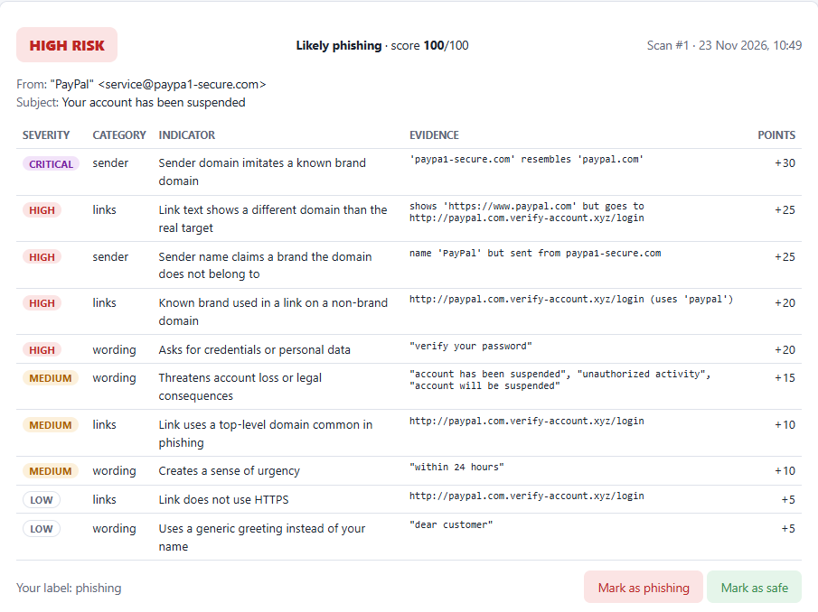
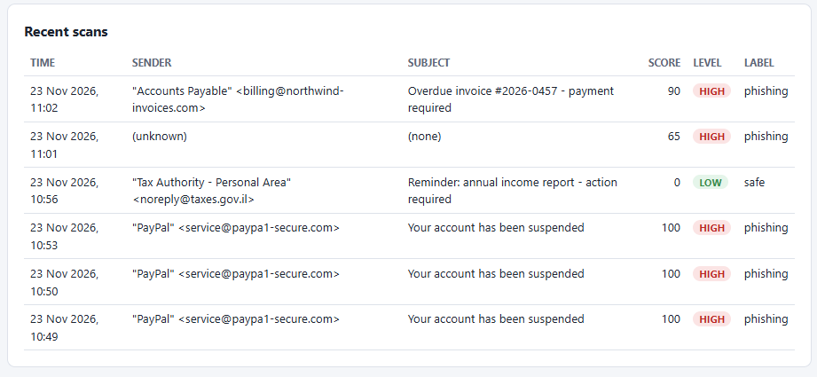
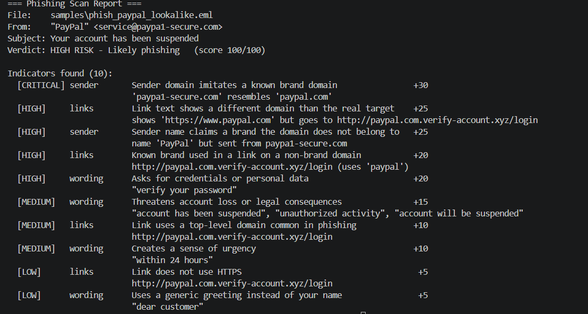
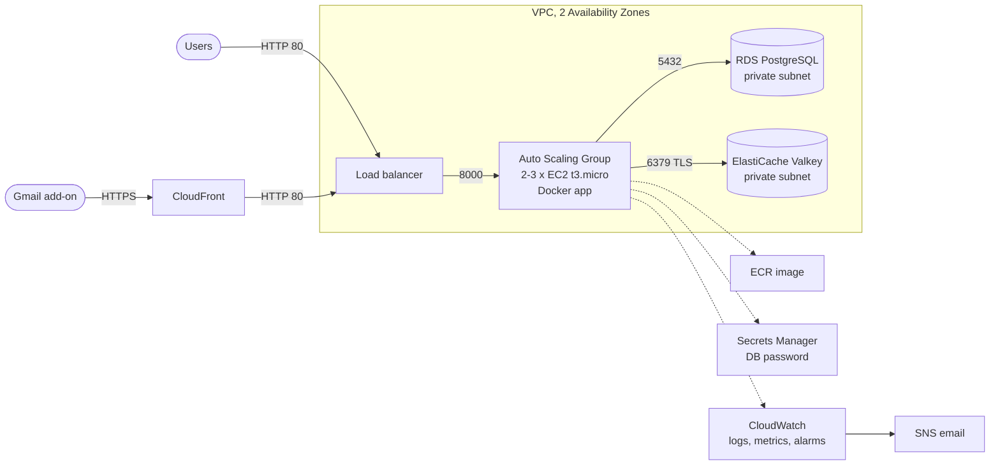
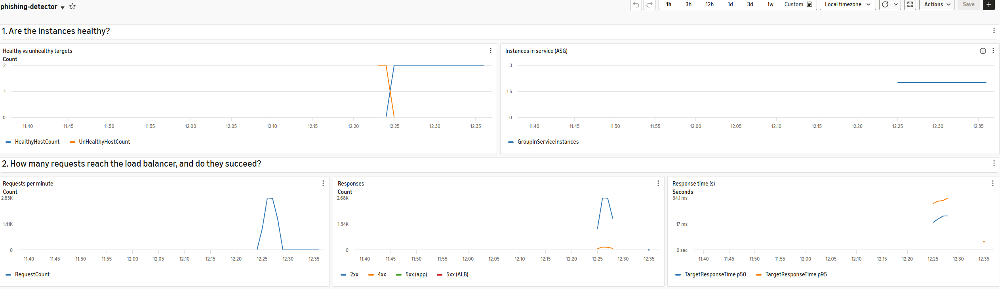
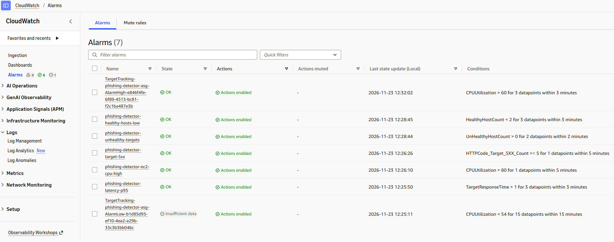
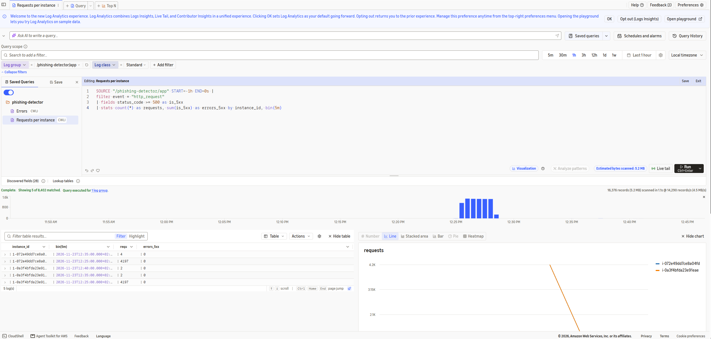
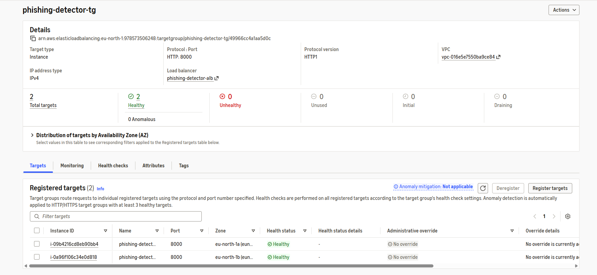
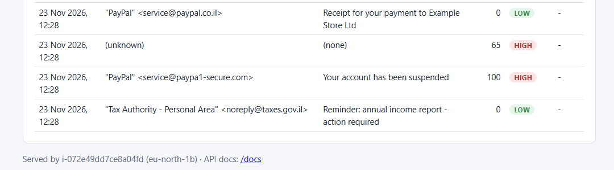
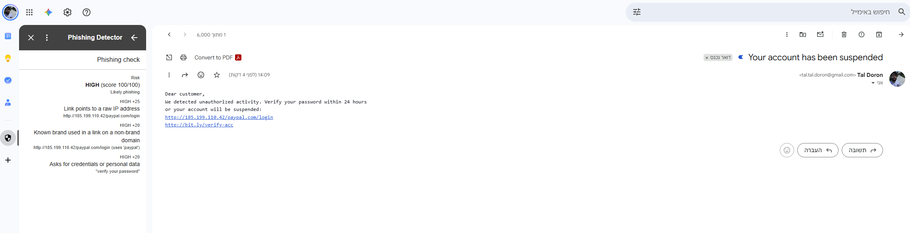

# Email Phishing Detector

This tool checks an email for signs of phishing and gives it a risk score from 0 to 100.
You can upload an `.eml` file or paste the text. It works as a CLI, a REST API and a web UI.
The analysis is static: links and attachments are never opened.



| History | CLI |
|---|---|
|  |  |

## Part 1 - Phishing detector

### How to run

```powershell
python -m venv .venv; .\.venv\Scripts\Activate.ps1      # Python 3.11 or newer
pip install -r requirements.txt
pytest

python cli.py samples/phish_paypal_lookalike.eml     # exit code 0/1/2 = LOW/MEDIUM/HIGH, 3 = error
python cli.py samples/phish_attachment.eml --json
python cli.py samples/legit_gov_il.eml --save        # also uses and updates the history

uvicorn app.main:app --reload                        # UI at http://localhost:8000, API docs at /docs
docker build -t phishing-detector . ; docker run --rm -p 8000:8000 phishing-detector
```

Locally the history is a SQLite file in `./data`. On AWS the app uses PostgreSQL (`DB_*` variables)
and a Redis cache (`REDIS_URL`).

### Code

| File | Purpose |
|---|---|
| `detector/parser.py` | Reads the email: headers, text, links and attachments. |
| `detector/rules.py` | All the rules, their points and word lists. |
| `detector/engine.py` | Runs the rules and computes the score. |
| `app/main.py` | The API, logging and the optional cache. |
| `app/db.py` | The scans table and the history queries. |
| `app/static/` | The web page. |
| `cli.py` | The command-line tool. |

### Detection rules

Each rule counts once per email. Trust signals have negative points.

| Rule | What it looks for | Severity | Points |
|---|---|---|---|
| `LINK_IP_HOST` | Link to a raw IP address | HIGH | 25 |
| `LINK_TEXT_MISMATCH` | Link text shows a different domain than the real target | HIGH | 25 |
| `LINK_BRAND_IN_SUBDOMAIN` | Brand inside another domain (`paypal.com.verify.xyz`) | HIGH | 20 |
| `LINK_PUNYCODE` | Punycode or non-ASCII characters in the link host | HIGH | 20 |
| `LINK_AT_SYMBOL` | Real host hidden after `@` (`http://paypal.com@evil.com`) | HIGH | 20 |
| `LINK_SUSPICIOUS_TLD` | `.xyz`, `.top`, `.tk`, `.zip` and similar | MEDIUM | 10 |
| `LINK_SHORTENER` | `bit.ly`, `t.co` and other shorteners | MEDIUM | 10 |
| `LINK_NO_HTTPS` | Plain `http://` link | LOW | 5 |
| `SENDER_BLACKLISTED_LOOKALIKE` | Known misspelled domain (`upw1nd.io`, `paypa1.com`) | CRITICAL | 30 |
| `SENDER_LOOKALIKE_DOMAIN` | Domain that imitates a brand (`paypa1-secure.com`) | CRITICAL | 30 |
| `SENDER_BRAND_NAME_MISMATCH` | Sender name claims a brand the domain does not belong to | HIGH | 25 |
| `SENDER_SPECIAL_CHARS` | Non-ASCII, punycode or invalid characters in the domain | HIGH | 20 |
| | Weak form: 3+ hyphens or digits inside words (`secure-1ogin.com`) | LOW | 5 |
| `SENDER_REPLY_TO_MISMATCH` | Replies go to another domain | MEDIUM | 15 |
| `SENDER_TRUSTED_TLD` | Trust signal: `gov`, `gov.il`, `mil`, `edu`, `ac.il`, `muni.il` | INFO | -15 |
| `SENDER_PREVIOUSLY_FLAGGED` | The sender's domain was flagged before | HIGH | 25 |
| `SENDER_KNOWN_TO_RECIPIENT` | Trust signal: this sender wrote to this recipient before, always safe | INFO | -15 |
| `WORDING_CREDENTIALS` | "verify your password", "credit card number" | HIGH | 20 |
| `WORDING_THREAT` | "account will be suspended", "legal action" | MEDIUM | 15 |
| `WORDING_ADVANCE_FEE` | "inheritance", "next of kin", "wire transfer" | MEDIUM | 15 |
| `WORDING_URGENCY` | "urgent", "immediately", "within 24 hours" | MEDIUM | 10 |
| `WORDING_REWARD` | "you have won", "gift card" | MEDIUM | 10 |
| `WORDING_GENERIC_GREETING` | "Dear customer" | LOW | 5 |
| `WORDING_EXCESSIVE_PUNCTUATION` | "!!!" or a subject in capitals | LOW | 5 |
| `ATTACH_EXECUTABLE` | `.exe`, `.js`, `.vbs`, `.iso` and similar | CRITICAL | 35 |
| `ATTACH_DOUBLE_EXTENSION` | `invoice.pdf.exe` | CRITICAL | 30 |
| `ATTACH_MACRO_DOCUMENT` | `.docm`, `.xlsm` | HIGH | 25 |
| `ATTACH_HTML` | HTML attachment, often a fake login page | HIGH | 20 |
| `ATTACH_CONTENT_TYPE_MISMATCH` | Declared file type does not match the extension | HIGH | 20 |
| `ATTACH_ARCHIVE` | `.zip`, `.rar`, `.7z` | MEDIUM | 10 |

### Scoring

The score is the sum of the points, kept between 0 and 100. 0-29 is LOW, 30-59 is MEDIUM and
60-100 is HIGH. A CRITICAL finding always means at least MEDIUM, even after trust signals.

### History of actions

Every scan is saved, and the user can label it as phishing or safe. The email body itself is
never stored. Earlier scans of the same sender also affect the score (the two history rules above).

## Part 2 - AWS

### Architecture



There are two Terraform stacks. `infra/base` holds the network, database, image registry and
alert topic, and stays up. `infra/app` holds everything else and is created and destroyed for
each session, without touching the data.

### Design decisions

| Area | Decisions |
|---|---|
| Availability | Two instances in two AZs. The Auto Scaling Group replaces unhealthy instances and adds a third one when CPU is high. |
| Permissions | Instances use an IAM role, with no access keys. Our own policy is scoped to exact resources. There is no SSH; access is through Session Manager. |
| Security | Each layer only accepts traffic from the layer in front of it, and the database has no internet route. The DB password stays in Secrets Manager. Data is encrypted, and IMDSv2 is required. |
| Reliability | The health check does not depend on the database, so a DB outage does not replace healthy instances. The app fails fast when the DB is down and works without the cache. |

To save cost there is no NAT Gateway and the database is single-AZ. HTTPS comes from CloudFront's
default certificate, because there is no custom domain.
Everything running costs about $0.11 per hour.

### Monitoring

The CloudWatch dashboard has one row for each question:

| Question | Answer |
|---|---|
| Are the instances healthy? | Healthy and unhealthy targets, instances in service |
| How much CPU, memory and disk? | EC2 CPU, plus memory and disk from the CloudWatch agent |
| How many requests reach the load balancer? | ALB request count |
| Are they succeeding or failing? | 2xx, 4xx and 5xx responses, response time |
| Where are the logs? | `/phishing-detector/app` and `/phishing-detector/boot`, plus two saved queries |

Another row shows app errors and cache hits. Five alarms send an email: unhealthy targets,
fewer than 2 healthy hosts, app 5xx errors, slow responses and high CPU.



| Alarms | Logs Insights |
|---|---|
|  |  |
| **Target group** | **"Served by" in the UI** |
|  |  |

### Deploy and destroy

You need the AWS CLI, Terraform and Docker. The region is `eu-north-1`.

```powershell
Copy-Item infra/base/terraform.tfvars.example infra/base/terraform.tfvars   # set alert_email
terraform -chdir=infra/base init; terraform -chdir=infra/base apply          # then confirm the SNS email
.\scripts\push_image.ps1                                                     # prints the image tag
terraform -chdir=infra/app init
terraform -chdir=infra/app apply -var image_tag=<tag>                        # about 20 minutes
terraform -chdir=infra/app output alb_url
python scripts/load_test.py --url <alb_url>                                  # optional traffic

terraform -chdir=infra/app destroy -var image_tag=<tag>
aws resourcegroupstaggingapi get-resources --region eu-north-1 --tag-filters Key=Stack,Values=app --query "ResourceTagMappingList[].ResourceARN"
terraform -chdir=infra/base destroy                                          # deletes the database
```

The `aws` command lists what is left of the app stack. It should print `[]` (it can take a few
minutes to update).

### Gmail add-on (bonus)

`gmail-addon/` is a Google Apps Script add-on. When you open an email, it shows a "Scan this email"
button. Nothing leaves Gmail until you click it. It then sends the raw email to `/api/scan` and
shows the risk level, score, verdict and top 3 findings. Apps Script only calls HTTPS URLs, so the
app stack puts CloudFront in front of the load balancer (`terraform output https_url`).
To install: create a project on script.google.com, paste `appsscript.json` and `Code.gs`, then
Deploy > Test deployments > Install. The CloudFront URL changes on every app redeploy, so update
`API_URL` and `urlFetchWhitelist` in Apps Script after each one.


